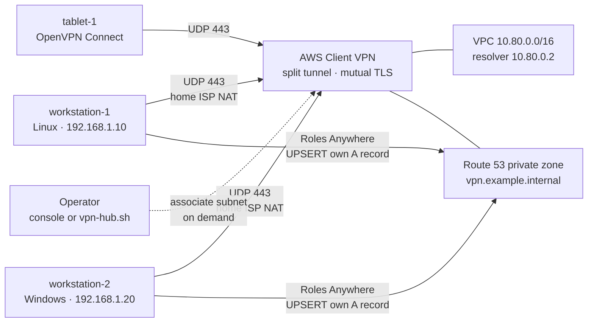

# AWS Client VPN hub

Arquitectura de referencia pública para un hub de AWS Client VPN con Terraform: túnel dividido, una zona privada de Route 53 e IAM Roles Anywhere. Los nombres, las direcciones y la cuenta de los ejemplos son ficticios.

A small, on-demand remote-access hub. Laptops on a private LAN and a tablet somewhere else all dial the same AWS Client VPN endpoint. Split tunnel keeps their internet traffic off AWS. Stable DNS names follow the tunnel addresses, and the laptops publish those names with IAM Roles Anywhere instead of long-lived access keys.

Topics: `aws`, `terraform`, `aws-client-vpn`, `split-tunnel`, `route53`, `iam-roles-anywhere`, `infrastructure-as-code`, `reference-architecture`.

This is a reference you can deploy in a lab account. It is not a production landing zone. The gaps are listed in [docs/design-decisions.md](docs/design-decisions.md).



The endpoint exists all the time. It accepts clients only while you associate it with a subnet. That association is the hourly meter, so Terraform does not create it.

## What it builds

Two Terraform stacks:

| Stack | Creates |
|---|---|
| `terraform/bootstrap` | S3 state bucket (versioning, public access blocked, TLS-only) and a customer-managed KMS key. Writes `terraform/hub/backend.hcl`. State for this stack stays local. |
| `terraform/hub` | VPC with no internet gateway, one private subnet (a second AZ is optional), a locked default security group, a Client VPN endpoint, mutual-TLS certificates, CloudWatch connection logs, two authorization rules, a private Route 53 zone, and an IAM Roles Anywhere trust anchor plus a role that can upsert only its own A record. |

It also writes a local bundle per device under `terraform/hub/out/`. Those bundles contain private keys and `.ovpn` profiles. They are gitignored. Do not email them or commit them.

Example names in the default variables:

| Device | Role | Example LAN address | DNS name while connected |
|---|---|---|---|
| `workstation-1` | Linux, publishes DNS | `192.168.1.10` | `workstation-1.vpn.example.internal` |
| `workstation-2` | Windows, publishes DNS | `192.168.1.20` | `workstation-2.vpn.example.internal` |
| `tablet-1` | Tablet client, no DNS updater | none on the LAN | connects with its own certificate |

`192.168.1.0/24` is a documentation range. It is not configured in AWS. Set `home_lan_cidr` to your LAN so Terraform can warn you if the hub ranges overlap it. Change `client_devices` if you want different names. The common name on each certificate is the DNS label.

Default addressing, chosen so the three ranges do not overlap:

| Network | CIDR |
|---|---|
| Example LAN | `192.168.1.0/24` |
| VPC | `10.80.0.0/16` (subnet `10.80.1.0/24` in the first available AZ) |
| VPN clients | `10.81.0.0/22` (AWS requires /22 to /12; you cannot change it later) |
| VPC resolver | `10.80.0.2` |

Split tunnel sends only `10.80.0.0/16` and `10.81.0.0/22` through the VPN. Everything else, including the public internet, uses the device's own connection.

## Prerequisites

- Terraform `>= 1.10` and AWS CLI v2.
- An AWS **member account** in AWS Organizations. Do not use the management account and do not use the root user. The account guard in both stacks refuses the management account, and it fails if the account is not in an organization.
- A region where Client VPN is available. The default is `mx-central-1` (Queretaro), which is an opt-in region: enable it on the member account from the management account before you apply. Any other Client VPN region works if you set `aws_region`.
- IAM Identity Center (or another temporary-credential profile) mapped to `AWS_PROFILE`. The examples use the profile name `vpn-hub`. A lab can use the `AdministratorAccess` permission set. Replace that with a scoped set before this hub is anything but a lab. See [Security notes](#security-notes).
- OpenVPN on each client. Linux uses OpenVPN as a systemd service. Windows uses OpenVPN Community with the OpenVPN Service component. The tablet uses OpenVPN Connect.
- For the DNS updater only: AWS CLI v2 and [aws_signing_helper](https://docs.aws.amazon.com/rolesanywhere/latest/userguide/credential-helper.html) on the LAN hosts. The tablet does not run it.

Suggested account setup:

1. In the management account, create a member account. An example OU path is `root / prod / prj-vpn-hub`. Those names are examples.
2. Enable the hub region on that member account if it is opt-in.
3. Assign your Identity Center user a permission set on the member account. Sign-in user names and email addresses stay in Identity Center. Do not put them in this repository.
4. Configure the CLI. The SSO region is the Identity Center home region, which may differ from the hub region. The profile's default region is the hub region.

```bash
aws configure sso --profile vpn-hub
aws sts get-caller-identity --profile vpn-hub --query Account --output text
```

Put that 12-digit account id in `expected_account_id` inside `terraform.tfvars` only. In docs and examples the placeholder is `<aws-account-id>` or `000000000000`.

## Deploy

From the repository root, with `AWS_PROFILE` set:

```bash
export AWS_PROFILE=vpn-hub

cd terraform/bootstrap
cp terraform.tfvars.example terraform.tfvars
# Edit expected_account_id and owner. Leave the file uncommitted.
terraform init
terraform plan
terraform apply
```

Bootstrap writes `terraform/hub/backend.hcl` (gitignored) with the bucket name, the KMS key, and `use_lockfile = true`.

```bash
cd ../hub
cp terraform.tfvars.example terraform.tfvars
# Same account id and owner. Adjust client_devices and home_lan_cidr.
terraform init -backend-config=backend.hcl
terraform plan
terraform apply
terraform apply
```

Run `apply` a second time after the endpoint is first created. With AWS provider 6.71.0 (pinned in `.terraform.lock.hcl`), `disconnect_on_session_timeout = false` is not sent on create. The second apply sets it so clients reconnect when the 24-hour session ends. `tests/aws/verify-hub.sh` checks for that drift.

The endpoint stays in `pending-associate`. Nothing can connect yet, and the hourly association charge has not started.

Useful outputs:

```bash
terraform output vpn_subnets
terraform output device_dns_names
terraform output client_bundles
```

Copy each directory under `terraform/hub/out/<device>/` to that device (USB or a trusted LAN copy). Treat it as a secret. Then follow [docs/client-setup.md](docs/client-setup.md).

## Turn the hub on and off

AWS bills Client VPN per associated subnet-hour and per connection-hour. Leave the association off until someone needs it.

CloudShell is not available in `mx-central-1`. Open the console in a region that has CloudShell (for example `us-east-2`) and run the script there. The script always calls the hub region.

```bash
# from a machine with the repo, or after copying scripts/aws/vpn-hub.sh
bash scripts/aws/vpn-hub.sh --status
bash scripts/aws/vpn-hub.sh --enable    # associate the subnet and add 10.81.0.0/22 -> local
bash scripts/aws/vpn-hub.sh --disable   # drop the association; AWS ends every session
```

`--enable` both associates the subnet tagged `vpn-hub-cvpn-<az>` and creates the client-to-client route. That `local` route is deleted whenever you disassociate, so it has to be created again on every enable. Doing only the console "Associate" step leaves clients unable to reach each other.

On each LAN host, after the association is up:

```bash
vpn-hub-service on      # Linux
vpn-hub-service off
```

```powershell
& 'C:\Program Files\vpn-hub\vpn-hub-service.cmd' on
& 'C:\Program Files\vpn-hub\vpn-hub-service.cmd' off
```

Connect the tablet by hand in OpenVPN Connect. About two minutes after a LAN host connects, its A record matches the current tunnel address.

Check the result without changing anything:

```bash
AWS_PROFILE=vpn-hub bash tests/aws/verify-hub.sh
AWS_PROFILE=vpn-hub bash tests/aws/verify-dns.sh workstation-1 workstation-2
```

## Cost

Prices below are the published US East (Ohio) example on the [AWS VPN pricing page](https://aws.amazon.com/vpn/pricing/), checked 2026-11-11: **$0.10 per hour** for one subnet association and **$0.05 per hour** for each connection. The page's worked example is Ohio. Other regions differ. Confirm the price for your region before you apply. Partial hours are billed.

The association meter runs whether or not anyone is connected. Disconnecting the clients does not stop it. Disassociating the subnet does.

Order of magnitude at those Ohio rates, 730 hours in a month:

| Pattern | Association | Connections | Client VPN hours, about |
|---|---|---|---|
| Associated all month, nobody connected | 730 × $0.10 | $0 | **$73** |
| Associated all month, 2 LAN hosts + 1 tablet | 730 × $0.10 | 3 × 730 × $0.05 | **$183** |
| On demand, 60 hours, those 3 clients | 60 × $0.10 | 3 × 60 × $0.05 | **$15** |
| Never associated | $0 | $0 | **$0** |

A second subnet (`enable_high_availability = true`) doubles the association line while both are associated.

Fixed charges are small next to a forgotten association: one Route 53 hosted zone, one KMS key, CloudWatch Logs, and the state bucket. Confirm them on the Route 53, KMS, CloudWatch, and S3 pricing pages. This VPC has no internet gateway, so Client VPN does not attach public IPv4 addresses to its interfaces. Split tunnel also keeps ordinary internet traffic off the VPN, which avoids NAT and the data-transfer surprise of a full tunnel. Traffic between clients still crosses the endpoint.

A budget resource is optional. Set `budget_alert_emails` to turn it on. The filter uses the `Project` tag, which a member account cannot activate as a cost-allocation tag; that activation is done in the payer account. Until then, read cost in Cost Explorer for this account.

Forgetting to disassociate is the expensive failure. One subnet plus two connected hosts is about **$0.20 per hour** at the Ohio connection rate ($0.10 + 2 × $0.05).

## Clean up

Destroy in this order. The hub state lives in the bucket that bootstrap created.

1. On each device, turn the VPN off and delete the local bundle, the OpenVPN profile, and the DNS updater. Steps are in [docs/client-setup.md](docs/client-setup.md#remove-a-device).
2. Disassociate the endpoint (`bash scripts/aws/vpn-hub.sh --disable`) while it is still up. `terraform destroy` fails if the association still exists.
3. Destroy the hub:

   ```bash
   cd terraform/hub
   terraform destroy
   ```

   This removes the endpoint, VPC, zone (including A records the laptops created), Roles Anywhere, the log group, and the local `out/` files. Private keys in the remote state go away with the state object.

4. If you uploaded `vpn-hub.sh` to a bucket yourself, empty and delete that bucket. Terraform does not create it. If you imported a certificate revocation list into Roles Anywhere, delete that CRL.
5. Destroy the state bucket:

   ```bash
   cd ../bootstrap
   terraform output -raw state_kms_key_arn   # note it if you want to confirm deletion later
   terraform destroy
   ```

   The KMS key is scheduled for deletion after `kms_deletion_window_days` (7 by default). Cancel with `aws kms cancel-key-deletion` if that was a mistake.
6. Delete local `terraform.tfstate` in `terraform/bootstrap` after the destroy, and any `*.tfplan` files. Plans can contain private keys.
7. The member account, the OU, and the enabled region are not Terraform resources. Close or keep them from the management account.

Read-only check that hub resources are gone:

```bash
AWS_PROFILE=vpn-hub bash tests/aws/verify-clean.sh --except-bootstrap
```

## Validate the code without AWS

```bash
bash tests/static/check-terraform.sh
terraform -chdir=terraform/bootstrap test
terraform -chdir=terraform/hub test
```

`check-terraform.sh` runs `terraform fmt -check` and `terraform init -backend=false` plus `terraform validate` in both stacks. The unit tests mock AWS, so they do not need credentials and they do not write `out/`.

## Security notes

What this reference already does:

- Mutual TLS with RSA 2048 certificates. Client VPN rejects other key types.
- No static IAM access keys. LAN hosts assume a role for one hour through Roles Anywhere, and the role can `UPSERT` only an `A` record whose name is `<certificate CN>.<zone>`.
- Remote state in S3 with versioning, Block Public Access, a TLS-only bucket policy, and SSE-KMS. Locking uses the S3 lock file (`use_lockfile`), not a DynamoDB table.
- The provider `allowed_account_ids` plus a postcondition that rejects the Organizations management account.
- Default security group has no rules. The endpoint security group allows outbound DNS only to the VPC resolver and all protocols only toward the client CIDR (that is the client-to-client path). It does not open SSH or RDP to the internet.
- No internet gateway, so there is no public IPv4 charge on the VPN interfaces and no path from the VPC to the internet.
- Standard tags on every resource: `Project`, `Environment`, `Owner`, `CostCenter`, `ManagedBy`.

What you still have to decide before this is more than a lab. Details and the tradeoff (cost over continuous availability) are in [docs/design-decisions.md](docs/design-decisions.md).

- The sample operator permission set is broad. Scope it.
- Host firewalls are not installed by these scripts. If the LAN must not reach SSH or RDP, limit those ports to `10.81.0.0/22` and `10.80.0.0/16`.
- Private keys live in the remote state. Anyone who can read the bucket and use the KMS key can extract them.
- Revoking a lost device is a manual CRL import. Removing it from `client_devices` is not enough.
- One Availability Zone. `enable_high_availability = true` adds a second subnet and a second hourly charge.
- Connection logs can contain client public addresses. Do not paste them into git. If you need a documentation address, use `203.0.113.10` (RFC 5737).

## Layout

| Path | What it is |
|---|---|
| [docs/architecture.md](docs/architecture.md) | Routes, DNS, security group, resource names |
| [docs/design-decisions.md](docs/design-decisions.md) | Why this shape, what was rejected, what is still missing |
| [docs/client-setup.md](docs/client-setup.md) | Install and remove the clients |
| [terraform/README.md](terraform/README.md) | Stacks, day-2 changes, destroy details |
| [scripts/](scripts) | `vpn-hub.sh` and the per-OS installers copied into each bundle |
| [tests/](tests) | Static checks, mocked Terraform tests, read-only AWS checks |

## License

[MIT](LICENSE). Copyright (c) 2026 Adolfo Orozco.
