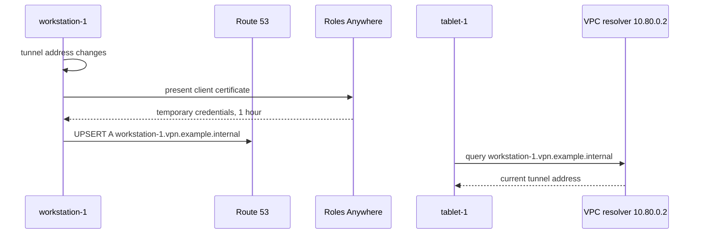
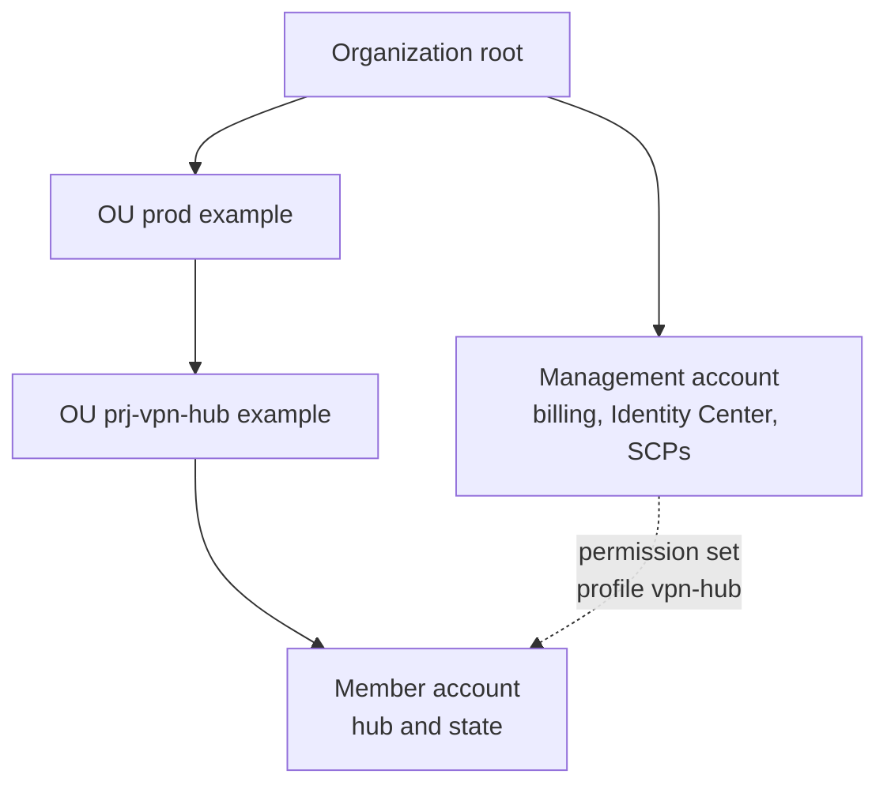

# Architecture

Home: [README](../README.md). Decisions and tradeoffs: [design-decisions.md](design-decisions.md). Client install: [client-setup.md](client-setup.md).

The hub is a meeting point, not an application VPC. There are no servers in it. Clients authenticate to AWS Client VPN with certificates, land on addresses in `10.81.0.0/22`, and reach each other through that range. A private DNS zone gives the LAN hosts stable names because the tunnel address changes on every connection.

## Components

| Piece | Choice |
|---|---|
| Client VPN endpoint | UDP 443, split tunnel, mutual TLS, 24-hour session, reconnect when the session ends |
| Certificates | One private CA. Server certificate in ACM in the same region. One client certificate per device. RSA 2048. |
| VPC | `10.80.0.0/16`, DNS hostnames and DNS support on, no internet gateway, no NAT |
| Association subnet | `10.80.1.0/24` in the first available AZ. Created by Terraform, associated by hand or by `scripts/aws/vpn-hub.sh` |
| Security group | Outbound DNS to `10.80.0.2/32` (UDP and TCP 53) and all protocols to the client CIDR. No inbound rules. Default SG emptied. |
| Route 53 | Private zone `vpn.example.internal`, associated with the VPC, `force_destroy = true` |
| IAM Roles Anywhere | Trust anchor is the same CA. Role `vpn-hub-dns-updater`, max session 1 hour |
| Logs | `/aws/clientvpn/vpn-hub`, stream `connections`, 90 days. Delivery can lag by tens of minutes. |
| State | `vpn-hub-tfstate-<aws-account-id>` with SSE-KMS key `alias/vpn-hub-tfstate` |

Resource names are a contract. `scripts/aws/vpn-hub.sh` and `tests/aws/` find resources by the `Name` tag or the resource name, not by an id stored in git.

| Resource | Name |
|---|---|
| Client VPN endpoint | `vpn-hub-cvpn` |
| VPC | `vpn-hub-vpc` |
| Association subnet | `vpn-hub-cvpn-<az>` |
| Endpoint security group | `vpn-hub-cvpn` |
| Locked default security group | `vpn-hub-default-locked` |
| Server certificate | `vpn-hub-server` |
| Private zone | value of `private_zone_name` |
| Log group | `/aws/clientvpn/vpn-hub` |
| Roles Anywhere | trust anchor `vpn-hub-ca`, profile and role `vpn-hub-dns-updater` |

## Routes and authorization

| Kind | Destination | Target | Why |
|---|---|---|---|
| Route | `10.80.0.0/16` | associated subnet | Created by AWS when you associate. Reaches the VPC resolver. |
| Route | `10.81.0.0/22` | `local` | Client-to-client. You create it on every associate. It disappears on disassociate. |
| Authorization | `10.80.0.0/16` | all groups | Without it the resolver does not answer. |
| Authorization | `10.81.0.0/22` | all groups | Without it the `local` route exists and the traffic is still denied. |

With certificate authentication there are no user groups to filter, so both rules use `authorize_all_groups`. A route-table change restarts every connection. Do not add `0.0.0.0/0` while split tunnel is on.

## DNS

The updater runs every two minutes and writes only when the address changed. The API call goes to the public Route 53 endpoint, using the certificate, not through the VPN. The tablet resolves the name through the VPN because the endpoint pushes `10.80.0.2` as its DNS server.

The zone must not end in `.local`. RFC 6762 reserves `.local` for multicast DNS, and iPadOS, macOS, and Ubuntu will not send those queries to the VPN DNS server. `.internal` is reserved by ICANN for private use. Terraform rejects a name that ends in `.local`.

## Account boundary

OU names are examples. Workloads stay in the member account. Service control policies on the parent OUs can still deny the region or the APIs; a deny there beats the permission set. Terraform does not manage the organization, the OU, or the account.

## Where the association lives

`aws_ec2_client_vpn_network_association` and the `local` route are absent from Terraform on purpose. If Terraform owned them, the next `apply` would turn the hub back on after an operator had turned it off, and the hourly charge would return. The endpoint, the authorization rules, and the subnet stay in code. The association does not.
